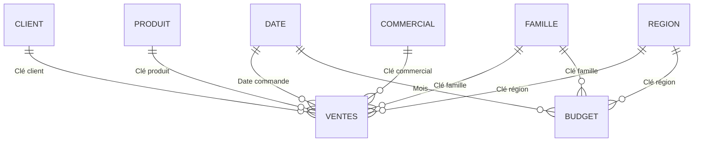

# Arvenor, négoce B2B : tableau de bord Power BI

Démo Power BI pour le dirigeant d'une PME de négoce de fournitures industrielles. Deux pages répondent à deux questions : **d'où vient la croissance**, et **où part la marge**.

> Données entièrement fictives : l'entreprise, ses clients, ses commerciaux et tous les chiffres sont générés par script.

Auteur : Otmane Boulahia ([LinkedIn](https://www.linkedin.com/in/otmane-boulahia), [Malt](https://www.malt.fr/profile/otmaneboulahia))

## Contexte

Arvenor est une PME fictive de négoce B2B : visserie, outillage, abrasifs, équipements de protection, produits de maintenance. Environ 900 clients professionnels, 600 références, 10 commerciaux répartis dans 5 régions, exercices 2024 et 2025. Le jeu de données contient une histoire à retrouver : croissance inégale selon les familles et les régions, hausse des coûts d'achat de la visserie en 2025, dérive des remises chez un commercial, clients et produits déficitaires. La [spécification](docs/specification.md) décrit l'entreprise, les règles de génération et chaque choix de conception.

## Ce que le rapport répond

Valeurs de l'exercice 2025, calculées par `scripts/expected_values.py` :

- **D'où vient la croissance ?** Le CA net progresse de 8,3 % sur un an et dépasse le budget de 0,9 %. La plus forte hausse vient de la famille Équipements de protection (+778 k€) et de la région Rhône-Alpes (+699 k€) ; le nombre de clients actifs progresse de 2,2 %, les commandes par client de 5,0 %, le panier moyen de 0,9 %.
- **Où part la marge ?** La marge commerciale ne progresse que de 2,6 % : son taux tombe à 31,4 % du CA net (-1,7 pts). Le pont de marge l'explique : hausse des coûts d'achat (-504 k€, surtout la visserie) et remises (-204 k€), avec un commercial dont le taux de remise passe de 10,9 % à 19,2 %. 12 clients ont une marge contributive négative et 8 produits sont vendus sous leur coût.

## Captures

> Emplacement réservé : capture de la page Vue Direction, à ajouter après le test dans Power BI Desktop (`docs/captures/vue-direction.png`).

> Emplacement réservé : capture de la page Marge, à ajouter après le test dans Power BI Desktop (`docs/captures/marge.png`).

## Pages

Deux pages de 1280 × 720 sur la même grille de 12 colonnes et 12 lignes. Les titres et les synthèses sont des mesures DAX : ils restent justes quel que soit le filtre ou le rôle de sécurité.

| Page | Question | Visuels |
|---|---|---|
| Vue Direction | D'où vient la croissance ? | Titre et synthèse calculés, segments Année et Région, bande de KPI (CA net, écart au budget, clients actifs, commandes par client, panier moyen, avec leur évolution), CA net mensuel comparé à N-1 et au budget, écarts de CA par famille, région et segment, écart au budget par famille |
| Marge | Où part la marge ? | Titre et synthèse calculés, segments, bande de KPI (marge commerciale, taux de marge, taux de remise, transport, marge contributive, avec leur évolution), pont de marge N-1 → N en cascade, écart de taux de remise par commercial, écart de taux de marge par famille, clients à marge contributive négative, produits vendus sous leur coût |

## Modèle

Modèle en étoile en mode Import, 11 tables : 2 tables de faits, 6 dimensions, 3 tables utilitaires (Mesures, Accès régional pour la sécurité, Étape du pont pour la cascade). 9 relations, toutes un-à-plusieurs et à sens unique. Famille et Région sont des dimensions partagées par les ventes et le budget, qui est défini par mois, famille et région.



Sécurité au niveau des lignes : le rôle Commercial ne laisse voir que les régions associées à l'adresse de connexion (`USERPRINCIPALNAME()`) dans la table Accès régional. Date/heure automatique désactivée, table de dates générée dans Power Query et marquée comme telle.

## Mesures

66 mesures dans la table Mesures, 62 visibles et 4 masquées, rangées en 6 dossiers : chiffre d'affaires (9), marge (9), comparaison N-1 (19), budget (5), pont de marge (10), textes (14). Chaque mesure a une description, un dossier et, hors mesures texte, un format. Dictionnaire complet, avec le DAX de chaque mesure : [docs/mesures.md](docs/mesures.md).

| Mesure | Définition | Format |
|---|---|---|
| CA net | Chiffre d'affaires hors taxes facturé, après remises : CA brut - remises | `#,0 €` |
| Marge commerciale (% CA) | Marge commerciale rapportée au CA net (taux de marque) | `0.0 %` |
| CA net évol. N-1 (%) | Évolution du CA net par rapport à la même période un an plus tôt | `+0.0 %;-0.0 %;0.0 %` |
| CA net budget | Budget de CA net ; vide dès qu'un filtre porte sur Client, Produit ou Commercial, dimensions absentes du budget | `#,0 €` |
| Effet volume | Marge N-1 × (CA net N au prix N-1 / CA net N-1 - 1) : le volume se mesure à prix constants | `+#,0 €;-#,0 €;0 €` |
| Titre Direction | Titre de la Vue Direction : évolution du CA net sur un an et position par rapport au budget | texte |

Le pont de marge décompose l'écart de marge commerciale entre N-1 et N en cinq effets, produit par produit : volume, mix, prix catalogue, remises et coût d'achat. Leur somme boucle exactement sur la marge N, ce que vérifient un test et la requête de validation.

## Valeurs attendues et obtenues

Les valeurs attendues sont calculées en pandas, indépendamment du DAX, par `scripts/expected_values.py` (fichiers `tests/expected/*.json`). La colonne « Obtenue » se remplit avec Power BI Desktop ; la requête `tests/validation.dax` compare les 409 valeurs d'un coup.

| Cas | Mesure | Attendue | Obtenue |
|---|---|---|---|
| 2025 total | CA net | 22 637 017 € | |
| 2025 total | CA net évol. N-1 (%) | 8,3 % | |
| 2025 total | CA net écart budget (%) | 0,9 % | |
| 2025 total | Marge commerciale | 7 099 071 € | |
| 2025 total | Marge commerciale (% CA) | 31,4 % | |
| 2025 total | Marge commerciale écart N-1 (pts) | -1,7 pts | |
| 2025 total | Effet volume | 504 337 € | |
| 2025 total | Effet mix | -21 814 € | |
| 2025 total | Effet prix catalogue | 406 123 € | |
| 2025 total | Effet remises | -203 641 € | |
| 2025 total | Effet coût d'achat | -504 061 € | |
| 2025 total | # Clients à marge négative | 12 | |
| 2025 total | # Produits sous le coût | 8 | |
| 2024 total | CA net | 20 910 166 € | |
| 2024 total | CA net évol. N-1 (%) | (vide) | |
| 2025 région Sud | Taux de remise (%) | 16,0 % | |
| 2025 région Sud | Effet remises | -162 686 € | |
| 2025 famille Visserie et fixations | Marge commerciale écart N-1 (pts) | -5,4 pts | |
| 2025 famille Visserie et fixations | Effet coût d'achat | -321 991 € | |
| Février 2025 | CA net évol. N-1 (%) | -3,1 % | |

## Contrôles automatiques

`make check` enchaîne, sans connexion :

- ruff (lint et format) et pytest : intégrité des données (clés, montants, dates, cohérence), présence de l'histoire, régénération identique des données, valeurs attendues et fichiers générés à jour, bouclage du pont de marge, détection effective des défauts par chaque contrôle ;
- validation de chaque fichier JSON du projet contre son `$schema`, avec les schémas en cache dans `tools/schemas/` ;
- liaisons : chaque table, colonne et mesure citée par le rapport existe dans le modèle TMDL ;
- règles de modèle : aucune relation bidirectionnelle, date/heure automatique désactivée, table de dates marquée, description, dossier et format sur chaque mesure, clés masquées ;
- mise en page : visuels dans le canevas, positions sur une trame de 8 px, aucun chevauchement, mêmes zones sur les deux pages ;
- typographie : aucun tiret cadratin dans les fichiers du dépôt.

La même commande tourne en intégration continue (GitHub Actions) sous Python 3.12 et 3.14.

## Ouvrir le projet

Power BI Desktop ne fonctionne que sous Windows ; la procédure complète, en six étapes, est dans [docs/test-windows.md](docs/test-windows.md). En résumé : ouvrir `NegoceB2B.pbip`, renseigner le paramètre `DossierDonnees` avec le chemin du dossier `data` (terminé par une barre oblique inverse), actualiser, puis coller `tests/validation.dax` dans la vue Requête DAX.

Le projet utilise les versions de schémas les plus récentes publiées par Microsoft ; Power BI Desktop doit être à jour pour les lire.

| Fichier | Schéma |
|---|---|
| `NegoceB2B.pbip` | pbipProperties 1.0.0 |
| `definition.pbir` | report definitionProperties 2.0.0 |
| `definition.pbism` | semanticModel definitionProperties 1.0.0 |
| `.platform` | platformProperties 2.1.0 |
| `report.json` | report 3.3.0 |
| `pages.json` | pagesMetadata 1.1.0 |
| `page.json` | page 2.1.0 |
| `visual.json` | visualContainer 2.13.0 |
| `version.json` | versionMetadata 1.0.0 |
| Thème personnalisé | reportThemeSchema 2.159, sur le thème de base Fluent2-CY26SU10 |
| Modèle TMDL | niveau de compatibilité 1600 |

## Régénérer

Python 3.12 ou plus récent :

```sh
make install   # environnement virtuel .venv et dépendances épinglées
make data      # data/*.csv, tests/expected/*.json et tests/validation.dax
make docs      # docs/mesures.md depuis le modèle TMDL
make check     # tous les contrôles
```

## Structure du dépôt

```text
NegoceB2B.pbip                 point d'entrée du projet Power BI
NegoceB2B.SemanticModel/       modèle sémantique en TMDL
NegoceB2B.Report/              rapport au format PBIR et thème
data/                          données fictives (CSV)
docs/                          spécification, dictionnaire des mesures, procédure Windows
scripts/                       génération des données, valeurs attendues, documentation, contrôles
tests/                         tests pytest, valeurs attendues, requête de validation DAX
tools/schemas/                 schémas JSON en cache pour la validation hors ligne
```

## Licence

[MIT](LICENSE).

## Auteur

Otmane Boulahia ([LinkedIn](https://www.linkedin.com/in/otmane-boulahia), [Malt](https://www.malt.fr/profile/otmaneboulahia)). Données entièrement fictives.
